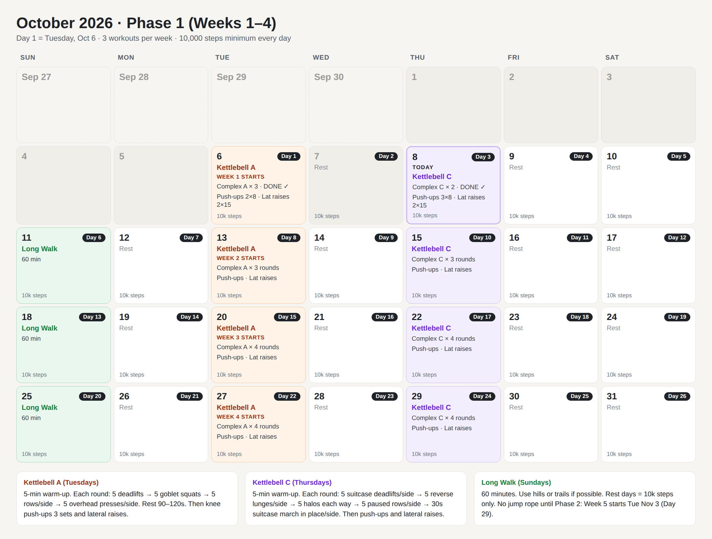
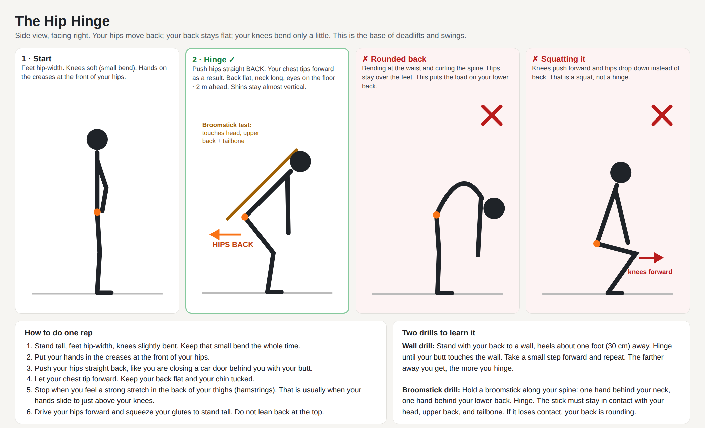

# 12-Week Workout Plan

- **Start:** Tuesday, October 6, 2026 (Day 1)
- **Weeks run Tuesday → Monday.** Week 5 starts Tuesday, November 3 (Day 29).
- **Goal:** work up to a consistent number of workouts per week, and walk a minimum of 10,000 steps every day.

---

## Daily steps

Walk a minimum of **10,000 steps every day**, starting on Day 1.

On workdays:
- Walk 10–15 minutes after each meal.
- Walk during phone calls and on your lunch break.
- Check your step count at 6 pm. If you're short, take an evening walk.

---

## Phase 1: Weeks 1–4 (3 workouts per week)

| Day | Workout |
|---|---|
| **Tuesday** | Complex A → knee push-ups → lateral raises |
| Wednesday | Rest (steps only) |
| **Thursday** | Complex C → knee push-ups → lateral raises |
| Friday | Rest (steps only) |
| Saturday | Rest (steps only) |
| **Sunday** | Long walk, 60 minutes |
| Monday | Rest (steps only) |

### Rounds

| Weeks | Complex A | Complex C |
|---|---|---|
| 1–2 | 3 rounds | 3 rounds |
| 3–4 | 4 rounds | 4 rounds |

**One round:** do every move in order, with no rest between moves or sides. Rest **90–120 seconds** after the last move.

**Per side:** do all the reps on one side, then all the reps on the other side, then go to the next move.

---

## Warm-ups (5 min, bodyweight)

If you're sore, do the warm-up twice (about 10 minutes).

| # | Complex A warm-up (Tuesday) | Complex C warm-up (Thursday) |
|---|---|---|
| 1 | Arm circles: 10 forward, 10 backward | Arm circles: 10 forward, 10 backward |
| 2 | Leg swings: 10 per leg | Leg swings: 10 per leg |
| 3 | Bodyweight squats: 10 | Bodyweight squats: 10 |
| 4 | Hip hinges at the wall: 10 | Hip hinges at the wall: 10 |
| 5 | Small hops in place: 30 s | Bodyweight reverse lunges: 5 per side |
| 6 | — | March in place: 30 s |

---

## Complex A (Tuesdays)

| # | Move | Reps | Current bell |
|---|---|---|---|
| 1 | Deadlift | 5 | 35 lb |
| 2 | Goblet squat | 5 | 15 lb (try 20 lb) |
| 3 | Bent-over row | 5 per side | 20 lb |
| 4 | Overhead press | 5 per side | 20 lb |

**Cues**
- **Deadlift:** bell between your feet. Hinge back with a flat back, then drive your hips forward to stand.
- **Goblet squat:** hold the bell at your chest by the horns. Sit between your heels with your chest up.
- **Row:** hinge forward and brace your free hand on your thigh. Pull the bell toward your hip.
- **Press:** squeeze your glutes and press straight up. Don't lean back.

## Complex C (Thursdays)

| # | Move | Reps | Current bell |
|---|---|---|---|
| 1 | Suitcase deadlift | 5 per side | 25 lb |
| 2 | Goblet reverse lunge | 5 per side | 20 lb |
| 3 | Halo | 5 each direction | 20 lb |
| 4 | Paused row (1 s hold at the top) | 5 per side | 25 lb |
| 5 | Suitcase march in place | 30 s per side | 20–25 lb |

**Cues**
- **Suitcase deadlift:** bell at your side like a suitcase. Don't lean toward it.
- **Reverse lunge:** step back and lower your back knee toward the floor.
- **Halo:** hold the bell upside down by the horns and circle it slowly around your head. Keep your ribs down.
- **Suitcase march:** stand tall and march in place with your knees to hip height. Don't lean. If you can't stay upright, use a lighter bell or just hold it still.

---

## Knee push-ups (after both kettlebell days)

**3 sets of 8–15 reps**, with 60–90 s rest. Stop 1–2 reps before your form breaks down.

**Form:** hands slightly wider than your shoulders. Straight line from your head to your knees. Elbows at about 45° from your body. Chest to a fist's height from the floor.

| Stage | What to do | Move on when |
|---|---|---|
| 1 | Knee push-ups, 3 × 8–15 (add 1 rep per set when the last set feels solid) | 3 × 15 with good form |
| 2 | Add 3 full push-up negatives (lower over 3–5 s) before the knee sets | The lowering stays controlled the whole way |
| 3 | As many full push-ups as you can, then finish each set on your knees | 3 × 8 full push-ups |

## Lateral raises (finisher, after push-ups)

Light dumbbells (5 lb). Raise to shoulder height only, with soft elbows and no shrugging. Lower over 2–3 s. Rest 60 s.

| Weeks | Sets × reps |
|---|---|
| 1–2 | 2 × 15 |
| 3–4 | 3 × 15–20 |
| 5+ | Build to 3 × 25, then go slightly heavier |

## Long walk (Sundays)

| Weeks | Time |
|---|---|
| 1–4 | 60 min |
| 5–8 | 75 min |
| 9–12 | 90 min |

Use hills or trails if you can.

---

## Phase 2 and later (weeks 5–12, to be confirmed around November 3)

- **Complex B replaces Complex A** on Tuesdays (needs a solid hip hinge):
  two-hand swing × 8 → clean × 5/side → overhead press × 5/side → goblet squat × 5 → reverse lunge × 5/side.
- **Complex C continues** on Thursdays, with heavier bells or more rounds.
- **Jump rope starts** at the beginner level and builds slowly (calves and Achilles tendons need time):

  | Rope weeks | Protocol |
  |---|---|
  | 1–2 | 8 × (20 s jump / 40 s rest) |
  | 3–4 | 10 × (30 s / 30 s) |
  | 5+ | 10 × (40 s / 20 s), then 3–4 × 3-min rounds |

- **To decide:** whether running (walk/run intervals) comes back, and whether to add a third kettlebell day.

---

## Rules

1. **Missed a workout?** Don't make it up. Do the next workout on the schedule.
2. **Missed a full week?** Repeat the last week you finished.
3. **Muscle soreness is normal.** Sharp pain, joint pain or Achilles pain means stop and rest that area for 2–3 days. Chest pain means stop and see a doctor.
4. **Sore or tired?** Do the longer warm-up, use lighter bells, or do fewer rounds. It still counts.
5. **Track:** daily steps, bell weights, rounds and push-up reps (see [log.md](log.md)).

## Body weight

Exercise improves fitness and body composition. The number on the scale depends mostly on food:
1. Eat a palm-sized portion of protein at each meal.
2. Cut back on drinks with calories: soda, juice, alcohol and sugary coffee drinks.

## Equipment

- Kettlebells: 15, 20, 25 and 35 lb
- Dumbbells: 5 lb
